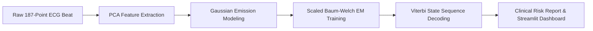

# 🫀 Arrhythmia Predicting HMM

> **Real-time cardiac arrhythmia detection & diagnostic pipeline using custom Gaussian Hidden Markov Models (Baum-Welch & Viterbi from scratch) and Streamlit.**

[](https://www.python.org/)
[](https://streamlit.io/)
[](https://www.kaggle.com/datasets/shayanfazeli/heartbeat)
[](LICENSE)

An end-to-end biomedical signal processing and machine learning pipeline that decodes, classifies, and stratifies cardiac arrhythmias. The core classification engine features a custom **Gaussian Hidden Markov Model (HMM)** built from scratch in vectorized NumPy/SciPy — implementing scaled Baum-Welch (EM) training and Viterbi decoding — paired with an interactive clinical **Streamlit** dashboard.

---

## 📌 Project Overview

Traditional arrhythmia classification often relies on deep black-box networks. This project demonstrates high-performance physiological modeling via **interpretable statistical mechanics**:

- **From-Scratch Gaussian HMM Engine:** Implements the Baum-Welch (Expectation-Maximization) training algorithm and Viterbi decoding algorithm from foundational mathematics without relying on third-party HMM libraries (`hmmlearn`, etc.).
- **High-Efficiency Scaled Forward-Backward:** Implements scaled forward/backward passes ($\alpha[t] = (\alpha[t-1] \mathbf{A}) \odot \mathbf{B}[t]$) to achieve rapid convergence without underflow.
- **PCA Dimensionality Reduction:** Reduces 187 raw ECG voltage samples down to principal components to strip high-frequency acquisition noise while preserving morphological wave characteristics.
- **Full & Diagonal Covariance Modes:** Captures cross-lead and cross-feature correlations across latent cardiac states.
- **Interactive Clinical Dashboard:**
  - **Mode A (Live Diagnostic):** Instant file-upload diagnosis. Evaluates patient ECG CSVs with risk categorization (Low, Moderate, High, Critical) and state transition reports.
  - **Mode B (Full MIT-BIH Benchmark):** Evaluates model precision, recall, F1, confusion matrices, and log-likelihood boundaries on the complete MIT-BIH dataset.

---

## 📊 Dataset Information

This project is trained and benchmarked against the **MIT-BIH Arrhythmia Database**, preprocessed into sampled heartbeat records (187 points sampled at 125 Hz).

### 📥 Where to Get the Full Datasets
Due to GitHub's 100 MB file size limit, the full raw training/testing CSV files (`mitbih_train.csv` ~411 MB and `mitbih_test.csv` ~102 MB) are omitted from this repository.

You can download the full datasets from either:
1. **Kaggle (Recommended):** [Heartbeat Dataset (MIT-BIH & PTB Database)](https://www.kaggle.com/datasets/shayanfazeli/heartbeat)
   - Download `mitbih_train.csv` and `mitbih_test.csv`
   - Place them directly into the root directory of this repository.
2. **PhysioNet:** [MIT-BIH Arrhythmia Database on PhysioNet](https://physionet.org/content/mitdb/1.0.0/)

> 💡 **Ready-to-Use Sample Patients:** This repository already includes multiple pre-packaged clinical patient test files (`patient_high_risk.csv`, `patient_low_risk.csv`, `patient_icu_recovering.csv`, `patient_tachycardia_burst.csv`, etc.) so you can immediately run **Mode A (Live Diagnostic)** without downloading the 500 MB training files!

---

## 🏗️ Pipeline Architecture



---

## 🚀 Quick Start & Installation

### 1. Clone the Repository
```bash
git clone https://github.com/AryanRajuBankar3000/Arrhythmia_Predicting_hmm.git
cd Arrhythmia_Predicting_hmm
```

### 2. Set Up Virtual Environment & Dependencies
```bash
# Create virtual environment
python -m venv .venv

# Activate virtual environment
# On Windows (PowerShell):
.venv\Scripts\Activate.ps1
# On Linux / macOS:
source .venv/bin/activate

# Install dependencies
pip install -r requirements.txt
```

### 3. Run the Streamlit Application
```bash
streamlit run app.py
```
Open **`http://localhost:8501`** in your browser.

---

## 🧪 Included Sample Patient Profiles

Test the diagnostic engine immediately using the bundled patient samples:
- `patient_low_risk.csv` - Healthy sinus rhythm profile
- `patient_high_risk.csv` - Persistent ventricular arrhythmia
- `patient_icu_recovering.csv` - Post-intervention recovering rhythm
- `patient_intermittent_pvc.csv` - Premature ventricular contractions
- `patient_tachycardia_burst.csv` - Accelerated episodic rhythm
- `patient_severe_multi_pathology.csv` - Multi-state acute cardiac anomaly

---

## 📈 Visualizations & Outputs

The engine generates multi-panel clinical diagnostics including:
- **ECG Lead Tracing with Beat Classification:** Synchronized visual overlay of detected normal vs. ectopic waveforms.
- **Log-Likelihood State Separation:** Density curves distinguishing normal cardiac dynamics from pathological transitions.
- **State Transition Probability Matrices:** Heatmaps revealing transition likelihoods between latent Markov states.

*(Precomputed dashboard outputs are viewable in the `output/` folder).*

---

## 📄 License

Distributed under the MIT License. See `LICENSE` for more information.
